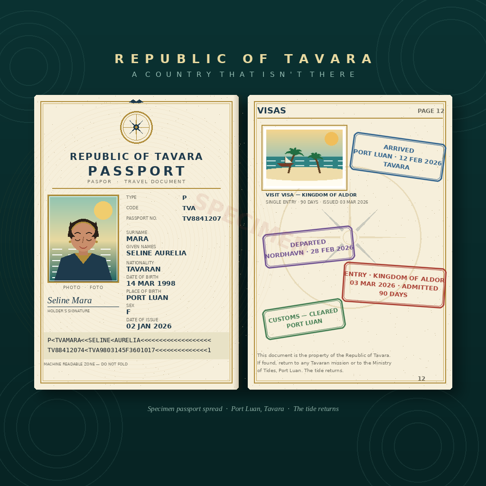

# The Passport Page of a Country That Isn't There

[](https://make.fun/competitions/the-passport-page-of-a-countr-2-20261121-0318)
[](https://make.fun/competitions/the-passport-page-of-a-countr-2-20261121-0318)
[](https://make.fun/competitions/the-passport-page-of-a-countr-2-20261121-0318)



## The country: the Republic of Tavara

Tavara is a coral-atoll nation in the South Pacific that appears on no
chart at high tide — eleven thousand people, one lagoon, and a motto that
is also a promise: **"The tide returns."** Its capital is Port Luan. Its
emblem is a frigate bird flying over an eight-point compass rose. Its
citizens travel on a passport the colour of lagoon water at dawn.

## The image

An open specimen passport spread, 1024×1024, flat-vector style:

- **Left page — the data page.** The Tavaran emblem, the holder Seline
  Aurelia Mara (born 14 Mar 1998 in Port Luan), a painted portrait, a
  signature, and a machine-readable zone with real MRZ check digits.
- **Right page — visas.** A compass-rose watermark, a visit-visa vignette
  of the atoll (two palms, a sailing canoe, the low sun), and four ink
  stamps telling one journey: arrived Port Luan, departed Nordhavn, entry
  to the Kingdom of Aldor, customs cleared. A faint diagonal SPECIMEN
  overprint marks the whole spread as a specimen.

Every detail is invented but internally consistent — one country, one
holder, one journey, one tide.

## How it is made

`main.ts` (Node 22 stdlib only) writes the finished PNG to
`$MAKEFUN_OUTPUT_DIR/entry.png`. The image bytes are embedded in the
program, so it is fully self-contained and deterministic: the same bytes
on every run, no network, no clock, no randomness. `generate.py` is the
script that drew the spread; `entry.png` is the finished image.

```sh
MAKEFUN_OUTPUT_DIR=/output node main.ts
# writes /output/entry.png — 1024×1024, deterministic
```

## License

MIT — see [LICENSE](LICENSE).
